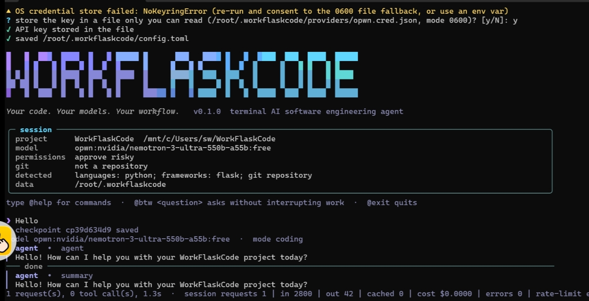

Ik this is vibecoded so I am greatly sorry

# WorkFlaskCode

An open-source AI coding agent for your terminal. Bring your own model: OpenRouter, any OpenAI-compatible endpoint, Anthropic, or a local server. WorkFlaskCode edits your project, runs your tests, keeps a task ledger that survives crashes and model switches, and never marks work done without evidence.

- Python 3.11+, MIT licensed, no telemetry. The only network traffic goes to the model provider you configure.
- The core needs just `pydantic`. `rich`, `prompt_toolkit`, `keyring` and `playwright` are optional and the app degrades cleanly without them.
- Works on Linux, macOS and Windows terminals. See [docs/platforms.md](docs/platforms.md) for what has and has not been tested.

 

## Install and run

```bash
git clone <your fork or this repository>
cd WorkFlaskCode
pip install -r requirements.txt
python3 workflaskcode.py
```

First run starts a setup wizard: pick a provider, supply a key (environment variable, OS keyring, or an explicitly consented 0600 file), choose a model from the provider's live model list, and choose a permission mode. Run `python3 workflaskcode.py doctor` any time to see what is and is not working.

Open a project by launching from its folder, with `--project DIR`, or with `@open <path>` / `@new <description>` inside the session.

```text
$ python3 workflaskcode.py --project ~/code/myapp
❯ add rate limiting to the login endpoint and cover it with tests
❯ @btw what does the session middleware do?      # answered without interrupting the work above
❯ @audit
❯ @tasks
```

Scripted use: `python3 workflaskcode.py run "fix the failing test" --yes` runs one task non-interactively. Exit codes: 0 completed, 1 failed, 2 usage error, 3 paused or limit reached, 130 cancelled. `--yes` auto-approves only non-destructive actions.

## What it does

| Area | Behaviour |
|---|---|
| Models | Model lists are fetched from the provider every time (cached briefly), never hardcoded. `@changemodel` switches mid-task without losing work. Fallback chain with backoff, jitter and Retry-After. No account rotation, no silent paid usage. |
| Safety | Four permission modes (read-only, approve-all, approve-risky default, restricted autonomous). Path-traversal and symlink-safe workspace. Agent data lives outside your project. This is an approval policy, **not an OS sandbox**: see [docs/security.md](docs/security.md). |
| Tasks | SQLite task ledger. A task only completes after recorded validation (tests, file checks). Checkpoints, `@rollback` of the agent's own edits, `@undo`, handoff files for resuming. |
| Modes | `@chat` read-only Q&A, `@codingagent` full agent, `@btw` concurrent read-only side questions that never touch the main task. |
| Code intelligence | Evidence-based `@audit`, `@security`, `@deps`, `@deadcode`, `@impact`, `@architecture`, `@test`, `@debug`, `@benchmark`, `@format`, `@types`. |
| Git | Status, diffs, branches, worktrees, changelog, PR descriptions, release checks. Never pushes, force-pushes or deletes branches for you. |
| Design | `@design-lock` records tokens, fonts, breakpoints, routes and naming so the agent preserves them; `@design-audit` and `@design-diff` detect drift. |
| Extensions | Permission-gated plugins, skills (instruction files), project templates, optional headless-browser checks. |

All 73 commands are in [docs/commands.md](docs/commands.md).

## Documentation

- [Getting started](docs/getting-started.md)
- [Providers and models](docs/providers.md)
- [Security model and its limits](docs/security.md)
- [Tasks, checkpoints and recovery](docs/tasks-and-recovery.md)
- [Plugins and skills](docs/plugins.md)
- [Design lock](docs/design-lock.md)
- [Architecture](docs/architecture.md)
- [Platforms](docs/platforms.md) and [troubleshooting](docs/troubleshooting.md)
- [Publishing to GitHub](docs/github.md)

## Development

```bash
pip install -r requirements-dev.txt
ruff check . && ruff format --check .
```

See [CONTRIBUTING.md](CONTRIBUTING.md).

## Honest limitations

- Static analysis (`@audit`, `@deadcode`, `@design-audit`) is heuristic. Findings state whether they are verified.
- Plugins run inside the agent process. They are permission-gated and consent is revoked when their code changes, but they are not sandboxed.
- The terminal UI paths for `rich`, `prompt_toolkit` and `keyring` are optional and have had less testing than the built-in fallbacks.
- Provider behaviour was not verified against live APIs.
